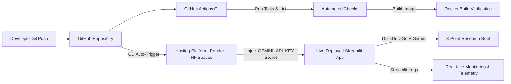

# Experiment 10: MLOps Deployment of the Task-Automation Agent

**Category**: Agentic AI / MLOps  
**Institution**: Kolhapur Institute of Technology's College of Engineering Kolhapur  
**Frameworks & Tools**: Streamlit, Google Gemini API, DuckDuckGo Search, Docker, GitHub Actions, Render / Hugging Face Spaces  

---

## 🎯 Aim
To deploy the search-and-summarize task-automation agent from Experiment 9 as a live web application using a student-level MLOps workflow (version control, Docker containerization, CI/CD pipeline, and basic monitoring) and document the complete procedure.

---

## 🛠️ Architecture & Workflow Diagram



---

## 📁 Repository Structure
```
├── .github/
│   └── workflows/
│       └── ci.yml             # GitHub Actions CI workflow (lint, test, docker build)
├── app.py                     # Streamlit web app with logging & search-summarize agent
├── Dockerfile                 # Container specification
├── requirements.txt           # Python dependencies
├── test_app.py                # Automated checks for CI
├── .env.example               # Template for environment secrets
├── .gitignore                 # Prevents committing secrets and virtual environments
└── README.md                  # Project documentation
```

---

## 🚀 Step-by-Step Task Execution

### Task 1 — Prepare the Application
The search-and-summarize agent workflow was migrated into a standalone Streamlit web app (`app.py`).
- Input: User enters a research topic.
- Output: An automated 3-bullet-point brief synthesized strictly from live DuckDuckGo web results using the Google Gemini API (`gemini-1.5-flash`).

### Task 2 — Version Control
1. Initialized Git repository:
   ```bash
   git init
   git add .
   git commit -m "feat: initial commit of task-automation agent with streamlit and dockerfile"
   ```
2. Configured `.gitignore` to ensure `.env` and sensitive credentials are never tracked.

### Task 3 — Containerize
1. Created an optimized `Dockerfile` based on `python:3.11-slim`.
2. Build the Docker image locally:
   ```bash
   docker build -t task-automation-agent .
   ```
3. Run container locally with environment variable:
   ```bash
   docker run -p 8501:8501 -e GEMINI_API_KEY="your_actual_key_here" task-automation-agent
   ```
4. Access at `http://localhost:8501`.

### Task 4 — Manage Secrets and Configuration
- Sensitive keys (`GEMINI_API_KEY`) are kept in `.env` locally or injected at container run-time.
- Secrets are NEVER hard-coded into the source code, Dockerfile, or repository.
- Hosting platforms (Render / Hugging Face Spaces) inject the key securely via their "Environment Secrets" dashboard.

### Task 5 — Continuous Integration (CI)
GitHub Actions workflow configured in `.github/workflows/ci.yml`:
1. Triggers on every `push` and `pull_request` to `main`.
2. Sets up Python 3.11 and installs requirements.
3. Executes automated syntax and unit tests (`python test_app.py`).
4. Builds the Docker container to ensure image build integrity before deployment.

### Task 6 — Continuous Deployment (CD)
1. Hosted on **Render** (as a Web Service) or **Hugging Face Spaces** (Docker SDK).
2. Connected directly to the GitHub repository.
3. Configured `GEMINI_API_KEY` under Environment Variables.
4. Auto-deploy triggers on every push to the `main` branch.

### Task 7 — Monitoring and Logging
- Configured Python standard `logging` in `app.py`:
  - Logs incoming topics.
  - Logs stage latencies (DuckDuckGo search duration & Gemini synthesis duration).
  - Logs any runtime errors or exceptions.
- Visible in the deployment console logs for performance tracking.

### Task 8 — Update Cycle (Full MLOps Cycle)
- Make a minor UI tweak or prompt change in `app.py`.
- Commit and push to `main`:
  ```bash
  git commit -am "chore: update app header and prompt formatting"
  git push origin main
  ```
- Observe GitHub Actions CI pass and the live hosting platform automatically rebuild and deploy the new version without downtime.

---

## 📋 Evaluation Checklist for Submission
- [ ] Working GitHub Repository link with `.gitignore` and CI workflow.
- [ ] Successful GitHub Actions CI run screenshot.
- [ ] Local Docker build and run screenshot.
- [ ] Deployment secrets configuration screenshot (with API key masked).
- [ ] Live URL on Render / Hugging Face Spaces.
- [ ] Live application screenshots showing 3-bullet research briefs for 2 different topics.
- [ ] Platform logs screenshot showing request duration and logging details.
