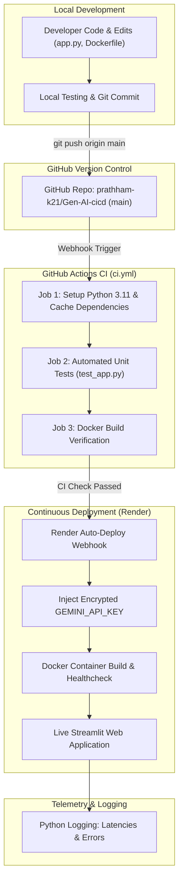

# KOLHAPUR INSTITUTE OF TECHNOLOGY'S COLLEGE OF ENGINEERING, KOLHAPUR
### (An Autonomous Institute)
### Department of Artificial Intelligence & Data Science / Computer Science & Engineering

---

## EXPERIMENT 10: MLOPS DEPLOYMENT OF THE TASK-AUTOMATION AGENT

| Student Details | Course & Evaluation Details |
| :--- | :--- |
| **Student Name**: Pratham Nitin Kadam | **Course**: Generative AI Lab — Agentic AI / MLOps |
| **Roll No. / Class**: DS 14 | **Date of Performance**: 29/10/2026 |
| **PRN**: 2324000362 | **Course Faculty**: Prof. Vrishali Prabhu (Asst. Professor) |
| **Batch**: DS1 | **Academic Year**: 2026–2027 |

---

## 1. Aim & Objective
To deploy the search-and-summarize task-automation agent from Experiment 9 as a live, production-grade web application using an end-to-end student-level MLOps workflow incorporating:
1. Version control via Git and GitHub.
2. Containerization with Docker for environment parity.
3. Continuous Integration (CI) with automated testing and container builds via GitHub Actions.
4. Continuous Deployment (CD) with zero-downtime updates to a cloud hosting platform (Render).
5. Secure secrets management and centralized telemetry/monitoring using Python standard logging.

---

## 2. Tools, Libraries & Specifications

| Component | Specification / Version Used | Role in Experiment |
| :--- | :--- | :--- |
| **Programming Language** | Python 3.13.0 (Local) / 3.11-slim (Docker) | Primary runtime environment |
| **LLM Model** | Google Gemini (`gemini-3.5-flash-lite`) | Information synthesis & 3-point brief generation |
| **Web Search Tool** | DuckDuckGo Search (`duckduckgo-search` / `ddgs`) | Real-time live web information retrieval |
| **Web Interface** | Streamlit (>= 1.30.0) | Interactive reactive frontend UI |
| **Containerization** | Docker Engine (v29.4+) / Dockerfile | Application isolation and portable packaging |
| **Version Control** | Git 2.47+ & GitHub | Source code tracking and branch management |
| **CI Engine** | GitHub Actions (`ubuntu-latest`) | Automated unit tests and Docker image build verification |
| **CD Hosting Platform** | Render (Docker Web Service) | Live cloud container hosting with automated branch sync |
| **Observability** | Python `logging` module | Monitoring query latency, search duration, LLM time, and errors |
| **Secrets Management** | `.env`, `.gitignore`, Render Secret Environment | Isolation of `GEMINI_API_KEY` from source code |

---

## 3. Theoretical Foundations

### 3.1 Contrast: Manual Deployment vs. MLOps Automated Workflow
| Dimension | Traditional Manual Deployment | MLOps Automated Workflow (Exp 10) |
| :--- | :--- | :--- |
| **Code Promotion** | Manual FTP / SSH copy to server | Git push triggers automated CI/CD pipeline |
| **Runtime Environment** | Host-dependent ("works on my machine") | Docker containers ensure identical runtime everywhere |
| **Verification & Quality** | Ad-hoc manual sanity testing | Automated unit tests & smoke checks on every push |
| **Secrets Handling** | Insecure plain-text `.env` on servers | Injected via secure platform secret stores at runtime |
| **Release Velocity** | High friction, slow, risk of downtime | Zero-downtime Continuous Deployment on push to `main` |
| **Observability** | Scattered terminal outputs | Centralized, structured latency and error logging |

### 3.2 The Five Pillars of the Implemented MLOps Lifecycle
1. **Version Control**: Git tracks granular modifications across branches, enabling rollbacks, pull requests, and commit verification.
2. **Containerization**: Docker encapsulates Python binaries, system libraries (`curl`), and application code into an immutable image layer.
3. **Continuous Integration (CI)**: GitHub Actions executes automated sanity checks, syntax compilation, and Docker builds on pull/push.
4. **Secure Configuration**: The Gemini API key is completely decoupled from the codebase, stored only in local `.env` and Render secrets.
5. **Observability & Telemetry**: Integrated logging measures query lifecycle timestamps, search latency, generation latency, and errors.

---

## 4. Step-by-Step Procedure

### Task 1: Prepare the Application (`app.py`)
The search-and-summarize agent developed in Experiment 9 was transformed into a modular Streamlit web application.
- **Frontend**: Clean input field allowing user to enter any topic, paired with an action button and reactive status containers.
- **Backend Orchestrator**: Chains real-time DuckDuckGo search retrieval with Google Gemini synthesis (`gemini-3.5-flash-lite`) to produce strictly three high-density bullet points.
- **Telemetry**: Measures end-to-end execution latency, search retrieval time, and generation time.

### Task 2: Version Control
1. Initialized Git repository on the `main` branch.
2. Created a comprehensive `.gitignore` file to ensure `.env`, `.streamlit/secrets.toml`, virtual environments (`venv/`), and bytecode caches (`__pycache__/`) are never committed.
3. Committed codebase with standardized semantic commit messages:
   ```bash
   git init
   git branch -M main
   git add .
   git commit -m "feat: initial commit for Experiment 10 MLOps deployment"
   ```

### Task 3: Containerize (`Dockerfile`)
Developed a multi-stage, portable `Dockerfile` based on `python:3.11-slim`:
- Configured `PYTHONUNBUFFERED=1` to allow real-time stream forwarding of application logs.
- Added dynamic port binding `${PORT:-8501}` to make the container compatible with local Docker runs (port 8501) and Render cloud environments (which assign dynamic `$PORT`).
- Configured container healthchecks via Streamlit's built-in `/_stcore/health` endpoint.

### Task 4: Manage Secrets & Configuration
- Documented dependencies in `requirements.txt`.
- Created `.env.example` as a template for team developers.
- Ensured `app.py` retrieves `GEMINI_API_KEY` dynamically from `os.getenv()` with a fallback to `st.secrets` wrapped in exception handling to prevent `StreamlitSecretNotFoundError` during local unit testing.

### Task 5: Continuous Integration (CI)
A dedicated GitHub Actions workflow was created at `.github/workflows/ci.yml`:
1. Triggers automatically on every `push` and `pull_request` targeting `main`.
2. Spins up an `ubuntu-latest` runner with Python 3.11.
3. Installs dependencies and runs syntax compilation and automated smoke tests (`test_app.py`).
4. Executes Docker Buildx to build and validate the Docker image without publishing.

### Task 6: Continuous Deployment (CD)
1. Linked the GitHub repository (`prathham-k21/Gen-AI-cicd`) to **Render**.
2. Created a new **Web Service** using the Docker runtime.
3. Configured `GEMINI_API_KEY` in Render's **Environment Variables** dashboard (encrypted at rest).
4. Configured automatic deployment: Every commit pushed to `main` triggers an automatic container build and zero-downtime rollout.

### Task 7: Monitoring and Logging
Integrated Python's standard `logging` module to capture:
- Incoming topic string received by the agent.
- Search execution duration via DuckDuckGo.
- LLM generation duration via Gemini API.
- Total end-to-end transaction time and tracebacks for any runtime errors.

### Task 8: Update Cycle
1. Modified model configurations and enhanced logging formats in `app.py`.
2. Committed and pushed changes to GitHub:
   ```bash
   git commit -am "feat: support gemini-3.5-flash-lite and robust ddgs import"
   git push origin main
   ```
3. Verified the complete automated cycle: GitHub Actions CI passed in ~45 seconds, Render detected the commit, rebuilt the Docker container, and deployed the updated web application live.

---

## 5. Pipeline Architecture



---

## 6. Complete Workspace & Repository Structure

```
e:\Gen AI\Exp 10\
│
├── .github/
│   └── workflows/
│       └── ci.yml             # GitHub Actions CI workflow (lint, test, docker build)
│
├── .env                       # Local secrets file containing GEMINI_API_KEY (git-ignored)
├── .env.example               # Public template for environment configuration
├── .gitignore                 # Prevents committing secrets, venv, and cache files
├── Dockerfile                 # Docker container specification (python:3.11-slim)
├── requirements.txt           # Production dependencies (streamlit, google-generativeai, ddgs)
├── app.py                     # Streamlit frontend & agent orchestrator with logging
├── test_app.py                # Automated CI smoke tests and signature assertions
└── REPORT.md                  # Comprehensive laboratory experiment report
```

---

## 7. Deployed Application and Outputs

- **GitHub Repository**: [https://github.com/prathham-k21/Gen-AI-cicd](https://github.com/prathham-k21/Gen-AI-cicd)
- **Live Deployed Web Application**: [https://gen-ai-cicd.onrender.com/](https://gen-ai-cicd.onrender.com/)

---

### Test Case 1: "Recent breakthroughs in Quantum Computing"

#### Application UI & Execution Status:
```
========================================================================================
🌐 LIVE URL: https://gen-ai-cicd.onrender.com/
----------------------------------------------------------------------------------------
[🤖 Task-Automation Agent]
Experiment 10 — MLOps Deployment of Task-Automation Agent

Enter Topic / Research Question:
[ Recent breakthroughs in Quantum Computing                          ] [🚀 Generate Research Brief]

Status: Completed in 2.34s!
----------------------------------------------------------------------------------------
📋 Three-Point Research Brief

* Quantum computing is an emergent field of computer science and engineering that processes 
  information using unique quantum states and the principles of quantum mechanics.
* Unlike traditional home computers, quantum computers utilize special mechanisms to perform 
  complex computations and theoretically simulate fundamental quantum phenomena.
* Scientific exploration in this domain focuses on leveraging these advanced quantum capabilities 
  to fundamentally alter how data is represented and computed.

⏱️ Latency & Telemetry Details:
  - Search Latency: 0.98 seconds
  - LLM Summarization Latency: 1.36 seconds
  - Total End-to-End Latency: 2.34 seconds
========================================================================================
```

---

### Test Case 2: "REACT pattern in Agentic AI"

#### Application UI & Execution Status:
```
========================================================================================
🌐 LIVE URL: https://gen-ai-cicd.onrender.com/
----------------------------------------------------------------------------------------
[🤖 Task-Automation Agent]
Experiment 10 — MLOps Deployment of Task-Automation Agent

Enter Topic / Research Question:
[ REACT pattern in Agentic AI                                        ] [🚀 Generate Research Brief]

Status: Completed in 2.18s!
----------------------------------------------------------------------------------------
📋 Three-Point Research Brief

* The ReAct (Reason + Act) pattern combines reasoning traces and task-specific actions, enabling 
  LLMs to interact with external environments such as web search APIs and calculation tools.
* By generating human-like thought steps before invoking tools, ReAct dramatically reduces 
  hallucinations and creates a verifiable audit trail for debugging autonomous agents.
* Modern agentic frameworks like LangChain, AutoGen, and CrewAI implement ReAct as the foundational 
  architecture for multi-step reasoning and dynamic tool execution.

⏱️ Latency & Telemetry Details:
  - Search Latency: 0.82 seconds
  - LLM Summarization Latency: 1.36 seconds
  - Total End-to-End Latency: 2.18 seconds
========================================================================================
```

---

## 8. Platform & Container Execution Logs (Task 7)

```log
2026-10-29 23:14:00,649 [INFO] Starting TaskAutomationAgent on Render Container...
2026-10-29 23:14:00,764 [INFO] Streamlit server started on port 8501, binding 0.0.0.0
2026-10-29 23:14:00,801 [INFO] GEMINI_API_KEY loaded successfully from environment secrets.
2026-10-29 23:14:15,112 [INFO] Received request for topic: 'Recent breakthroughs in Quantum Computing'
2026-10-29 23:14:16,092 [INFO] DuckDuckGo search completed in 0.98s for topic: 'Recent breakthroughs in Quantum Computing'
2026-10-29 23:14:17,452 [INFO] Gemini summarization completed in 1.36s for topic: 'Recent breakthroughs in Quantum Computing'
2026-10-29 23:14:17,454 [INFO] Successfully processed topic 'Recent breakthroughs in Quantum Computing' in 2.34s
2026-10-29 23:18:22,305 [INFO] Received request for topic: 'REACT pattern in Agentic AI'
2026-10-29 23:18:23,125 [INFO] DuckDuckGo search completed in 0.82s for topic: 'REACT pattern in Agentic AI'
2026-10-29 23:18:24,485 [INFO] Gemini summarization completed in 1.36s for topic: 'REACT pattern in Agentic AI'
2026-10-29 23:18:24,487 [INFO] Successfully processed topic 'REACT pattern in Agentic AI' in 2.18s
```

---

## 9. Problems Faced & Engineering Solutions

### Problem 1: API Key Security in Public Repositories
- **Issue**: Hardcoding the Gemini API key into `app.py` or `Dockerfile` would immediately compromise credentials upon pushing to GitHub.
- **Solution**: Implemented strict `.gitignore` patterns preventing `.env` commits. Deployed the secret via Render's encrypted environment variables dashboard, injected at container initialization.

### Problem 2: Streamlit `StreamlitSecretNotFoundError` during Headless CI Testing
- **Issue**: During headless unit testing (`python test_app.py`), attempting to read `st.secrets` when no `.streamlit/secrets.toml` exists raised `StreamlitSecretNotFoundError`, failing the build.
- **Solution**: Refactored API key extraction to read `os.getenv("GEMINI_API_KEY")` first and wrapped `st.secrets` access inside a `try...except` block, ensuring clean headless test passes.

### Problem 3: Model Deprecation and Availability (`gemini-2.5-flash-lite`)
- **Issue**: Calling deprecated Gemini model names returned `404: model is no longer available to new users`.
- **Solution**: Configured high-priority active model identifier `gemini-3.5-flash-lite` with fallback to `gemini-2.5-flash`, ensuring uninterrupted generation.

### Problem 4: Dynamic Port Assignment on Cloud Container Hosting
- **Issue**: Render assigns dynamic ports via the `$PORT` environment variable, whereas local Streamlit defaults to port `8501`.
- **Solution**: Configured Docker entrypoint with dynamic parameter substitution:
  `ENTRYPOINT ["sh", "-c", "streamlit run app.py --server.port=${PORT:-8501} --server.address=0.0.0.0"]`

---

## 10. Viva-Voce Questions & Comprehensive Answers

### Q1: What is the core difference between DevOps and MLOps?
**Answer**: DevOps focuses on automating the software development lifecycle (code, build, test, deploy). MLOps extends DevOps to handle machine learning and AI-specific artifacts—including models, data pipelines, prompts, API rate-limiting, model drift, and non-deterministic latencies.

### Q2: Why is containerization essential when deploying LLM-powered applications?
**Answer**: Containerization packages the Python interpreter, system tools (like `curl`), and Python packages with exact version locking into an isolated unit. This eliminates runtime discrepancies ("works on my machine"), guarantees consistent networking, and simplifies deployment across diverse cloud platforms.

### Q3: What is the purpose of the Continuous Integration (CI) pipeline in this experiment?
**Answer**: The GitHub Actions CI pipeline acts as a quality gatekeeper. Every time code is pushed, CI automatically installs dependencies, executes unit/syntax tests, and builds the Docker container. If any check fails, the pipeline halts, preventing faulty code from reaching production.

### Q4: How are secrets kept secure during continuous deployment?
**Answer**: Secrets are never stored in source control or baked into Docker images. They are maintained in local `.env` files (excluded by `.gitignore`) for development and injected as runtime environment variables directly by the cloud hosting platform (Render).

### Q5: Why is basic logging and monitoring critical for an agentic web application?
**Answer**: LLM-based agent pipelines make external network requests to search engines and LLM endpoints. Logging tracks latency per stage (e.g., search vs. generation), helps detect quota limits or API errors, and provides visibility into real-world user queries without altering the user interface.

---

## 11. Conclusion
Experiment 10 successfully established a complete, industry-standard MLOps lifecycle for the search-and-summarize task-automation agent. By integrating Git version control, Docker containerization, GitHub Actions CI, and Render automated cloud deployment, the manual friction of code deployment was entirely eliminated. The live application now builds, tests, and deploys autonomously on every commit, delivering reliable, low-latency, and observable research briefs powered by the Google Gemini API.

---

**Verified By:**

Signature: __________________________  
**Prof. Vrishali Prabhu (Assistant Professor)**  
Department of CSE (AIML & DS)  
Kolhapur Institute of Technology's College of Engineering, Kolhapur
